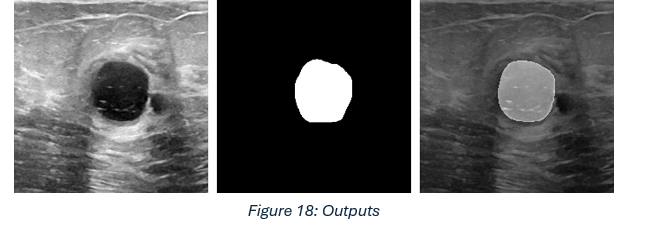

# Breast ultrasound classification and segmentation

This research project pairs image classification with mass segmentation in breast ultrasound. The classification pipeline assigns a benign, malignant or normal label. The segmentation pipeline produces a pixel mask that can be compared with the original ultrasound.

## Explore the experiments

| Task | Models and evidence |
| --- | --- |
| Classification | `MERN/app.py` contains ViT-B/16 and EfficientNetB0 inference paths for images and video. `efficient-net-final.ipynb` contains the EfficientNet experiment. |
| Segmentation | `unetr-b.ipynb` and `unet/unet-final.ipynb` contain the UNETR and U-Net experiments. The `unet/` directory includes example input, mask and prediction videos. |
| Evaluation | `unet/score.csv` records per-image F1, Jaccard, recall and precision. Its rows let readers inspect variation across examples. |
| Visualization | The broader project incorporated Unreal Engine visualization. `test.py` shows the Python side streaming image or video frames over a local WebSocket. The Unreal project assets are separate from this checkout. |

Some filenames, routes and older screenshots use “LLM” for the transformer path. The classifier behind that label is a vision transformer operating on ultrasound imagery.

## Reproduction

Start with the notebooks, example videos and score table. The inference services require trained checkpoints, including the ViT weights, EfficientNet weights and a Keras segmentation model referenced in `MERN/app.py`. Those files need to be supplied separately. The repository also includes a React client under `MERN/client/`, an Express account service under `MERN/server/`, and a separate Flask segmentation service in `MERN/dlapp.py`.

The evaluation table reports experimental results on the project data. It does not establish clinical performance.

## Making the experiments reproducible

A versioned manifest of dataset splits, preprocessing settings and checkpoint identifiers would help readers connect a notebook run to its prediction outputs and score table.
